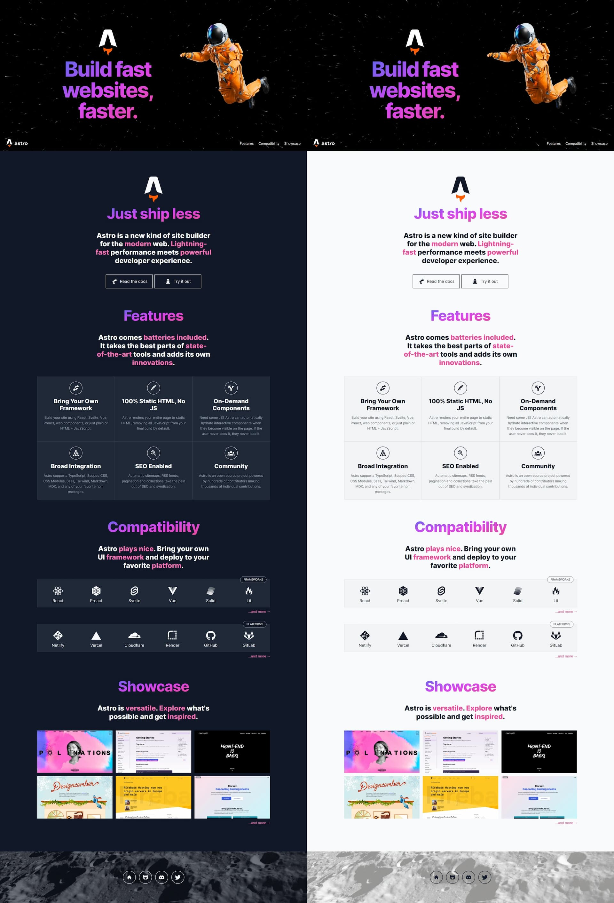

# Astro Landing Page

> An Astro + Tailwind CSS example/template for landing pages.

## Features

- 💨 Tailwind CSS for styling
- 🎨 Themeable
  - CSS variables are defined in `src/styles/theme.css` and mapped to Tailwind classes (`tailwind.config.cjs`)
- 🌙 Dark mode
- 📱 Responsive (layout, images, typography)
- ♿ Accessible (as measured by https://web.dev/measure/)
- 🔎 SEO-enabled (as measured by https://web.dev/measure/)
- 🔗 Open Graph tags for social media sharing
- 💅 [Prettier](https://prettier.io/) setup for both [Astro](https://github.com/withastro/prettier-plugin-astro) and [Tailwind](https://github.com/tailwindlabs/prettier-plugin-tailwindcss)

## Commands

| Command                | Action                                             |
| :--------------------- | :------------------------------------------------- |
| `npm install`          | Install dependencies                               |
| `npm run dev`          | Start local dev server at `localhost:3000`         |
| `npm run build`        | Build your production site to `./dist/`            |
| `npm run preview`      | Preview your build locally, before deploying       |
| `npm run astro ...`    | Run CLI commands like `astro add`, `astro preview` |
| `npm run astro --help` | Get help using the Astro CLI                       |
| `npm run format`       | Format code with [Prettier](https://prettier.io/)  |
| `npm run clean`        | Remove `node_modules` and build output             |

## API docs

Open `/docs?key=<RESTOCK_SECRET_KEY>` on any deploy for the restock API reference (Swagger UI). The page reads `/api/openapi.json`, which is built at request time from the Zod schemas in `src/lib/restock/schemas.js`. The route handlers validate with the same schemas, so a field cannot appear in the docs without the code accepting it, or the other way round. Try-it is enabled for GET only.

To document a new route: add its request and response schemas to `schemas.js` with `.meta({ description, example })`, validate in the handler with `safeParse`, and register the path in `src/lib/openapi.js`.

## Credits

- astronaut image
  - source: https://github.com/withastro/astro-og-image; note: this repo is not available anymore
- moon image
  - source: https://unsplash.com/@nasa
- other than that, a lot of material (showcase data, copy) was taken from official Astro sources, in particular https://astro.build/blog/introducing-astro/ and https://github.com/withastro/astro.build
