# Orble Beta

## Component Diagram

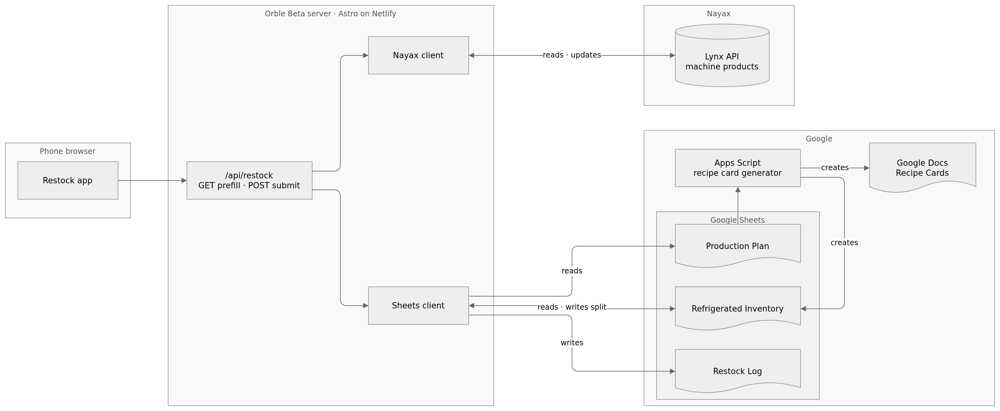

To update the diagram, open [components.drawio](components.drawio) at [app.diagrams.net](https://app.diagrams.net), edit, then export as PNG to `components.png`.

## API Reference

Open `/docs?key=<RESTOCK_SECRET_KEY>` on any deploy for the restock API reference (Swagger UI). It is built from the Zod schemas in `src/lib/restock/schemas.js`, the same schemas `/api/restock` validates every request with.

Flow chart: [Restock submit](restock.md) (POST).

## Batch Journey

### Day 0

**Write Production Plan**

The Production Plan specifies recipe, variation (flavor + size + topping + sweetness), how many to make, how many go to each machine, and which slot they go in.

**Prepare for Kitchen Shift**

Use Apps Script to generate recipe cards, drink labels with expiration dates, and create a refrigerated inventory tab for this batch with the expected storage values.

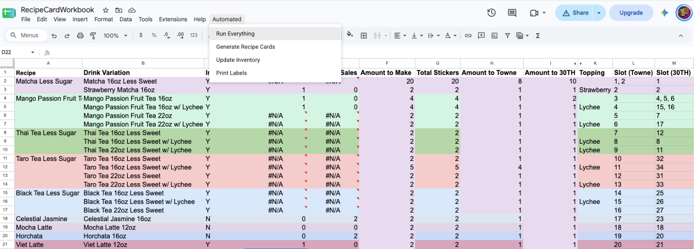
_Production Plan with Apps Script drop-down_

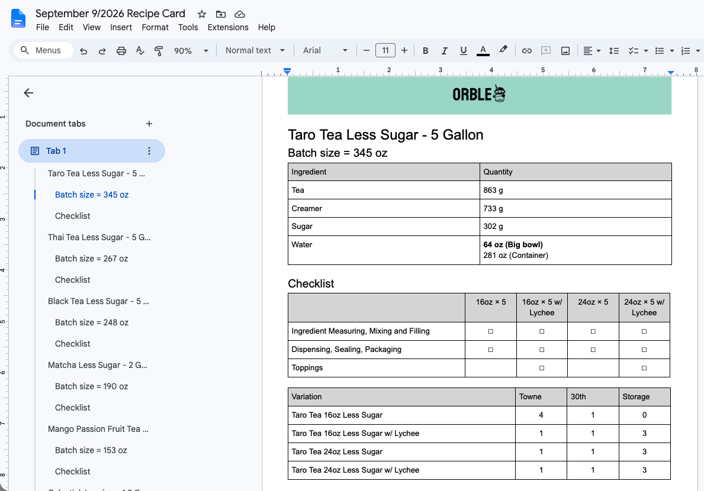
_Generated Recipe Card example_

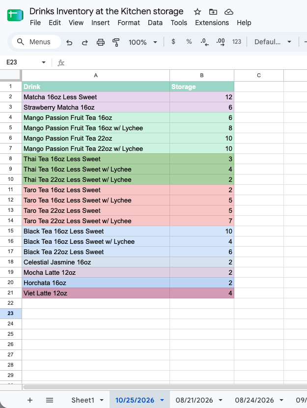
_Drinks Inventory pre-fill example_

### Day 1

**Kitchen Shift**

We make drinks using the recipe cards and place a label on each cup. Drinks going straight to a machine are packed into boxes while the rest go into refrigerated storage. We update the Inventory tab with what actually went into storage, since that can differ from the plan.

**Load**

1. Restocker selects machine and batch kitchen date. The system determines that this is a load event based on what is already in our logs for that batch.

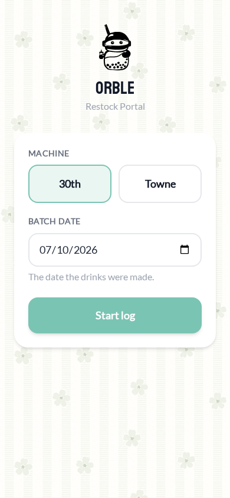

2. The app shows the restocker what to put in each slot. For a load, all existing drinks are thrown out so waste equals the previous amount, and the new values come from the Production Plan. Slots changing drinks show "replacing X" under the name. Each slot has an edit button and an approve checkbox. Approving folds the slot to a single line with the full drink name. Empty slots are greyed cards that also require approval.

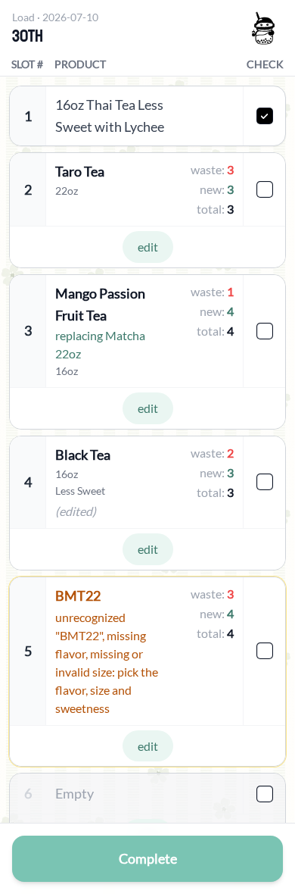

3. After the restocker loads the fresh drinks into the correct slots, they confirm each slot on the form with any necessary edits, and submit.

Tapping edit opens the slot with flavor, size, topping, sweetness, and steppers for waste and new. The strip at the top shows what the new drink is replacing and has its own edit in case something else is physically in the slot.

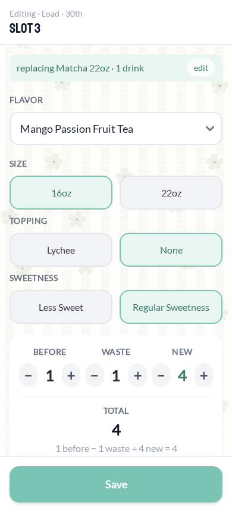

When Nayax reports a product code the system does not recognize, the edit screen opens with nothing preselected and asks the restocker to pick one of the valid flavors. Counts still prefill from Nayax.

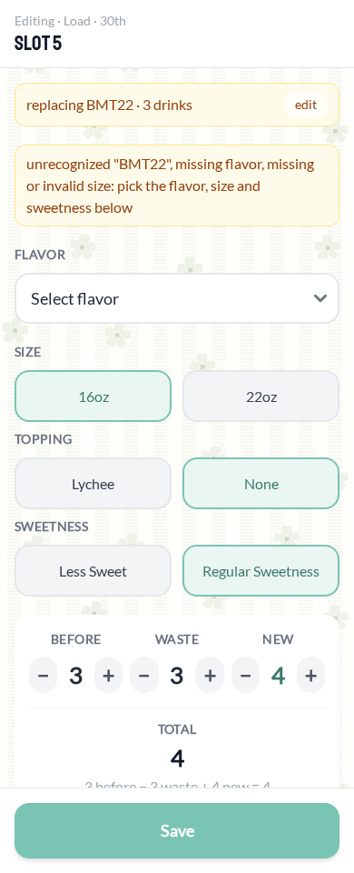

4. After the restocker confirms their submission went through, they can take the drink boxes back to the kitchen.

### Day 3 / 4 (depending on stock level)

**Split**

1. In the kitchen, the restocker picks either machine and the batch kitchen date. The system determines that this is a split event based on what is already in our logs for that batch. The machine picked does not matter.

2. The app calculates how many of each drink in storage go to 30th and to Towne, based on how much room each machine has in its slots right now. Each drink is one card with a check box.

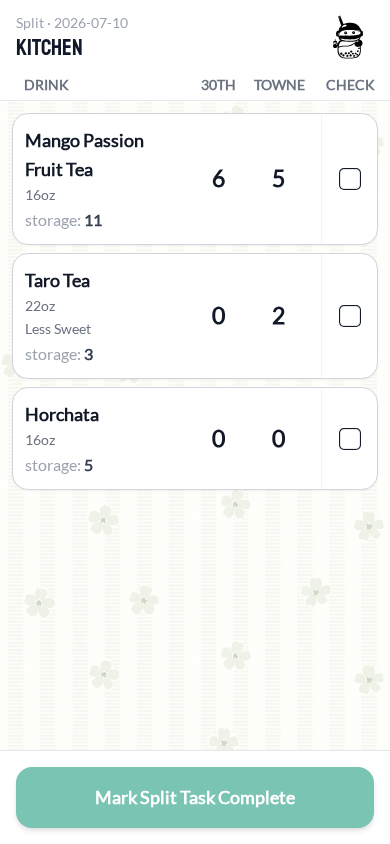

3. The restocker packs a box for each machine, checks off each drink, and marks the split complete.

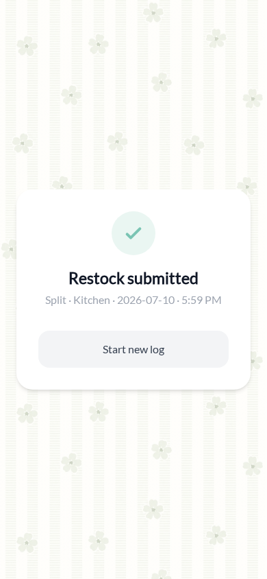

The split is written back to the Inventory tab for the batch.

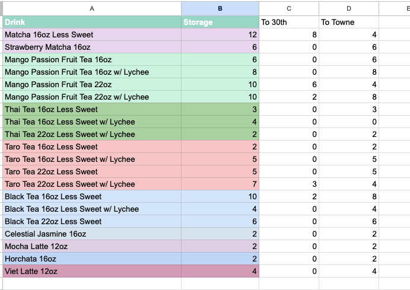
_Inventory tab after the split, with To 30th and To Towne filled in_

**Topoff**

1. At the machine, the restocker selects machine and batch kitchen date. The system determines that this is a topoff event.

2. The app shows each slot with the count before, waste 0, and new from the split calculation. The drinks stay the same, so only the counts change.

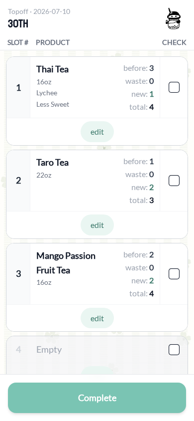

3. The restocker adds the drinks to each slot, confirms each slot on the form with any necessary edits, and submits.

### Day 6

The cycle repeats with a new batch. All drinks from the original batch are removed in the load.
