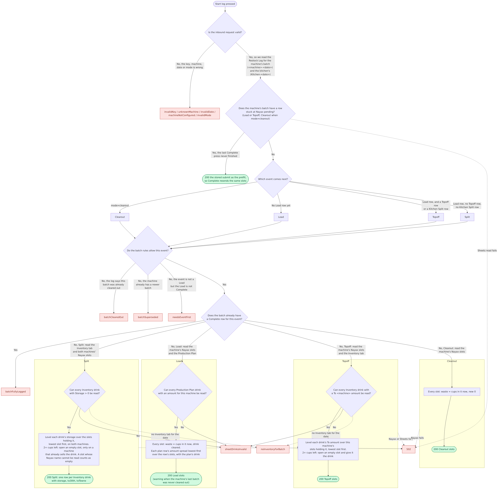
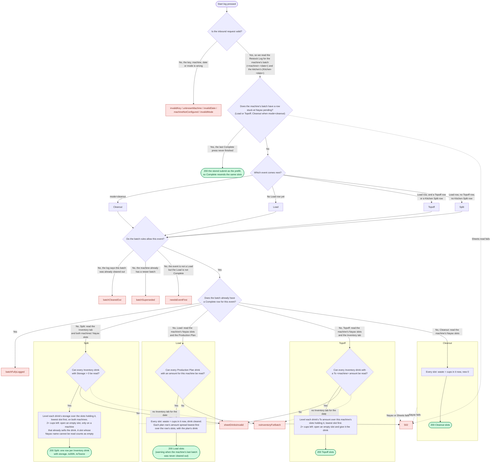

# Restock start log

Mermaid source (render with mermaid@11 to regenerate the PNG)

A slot whose Nayax record has no readable drink name or no on-hand count is
still returned, with a warning on it, so the restocker can fix it on the phone.
Warnings never turn the response into an error.
