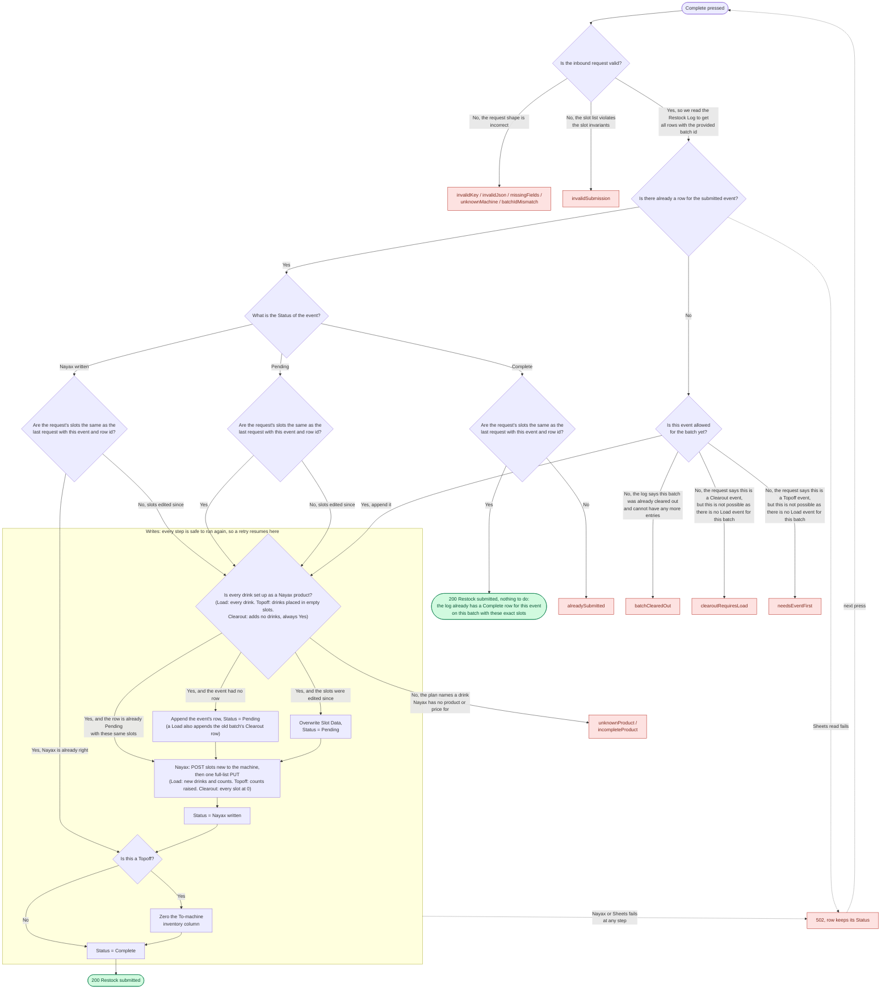

# Restock submit

How `POST /api/restock-submit` turns a confirmed restock into writes to Nayax,
the Restock Log, and the Inventory sheet, and how it recovers when one of those
writes fails.

## Events

A batch is one machine on one date (`30th-2026-07-10`). Three events can happen
to a batch:

| Event | What happens at the machine | Nayax | Restock Log | Inventory |
|---|---|---|---|---|
| Load | The old batch all comes out, the new batch goes in | each slot's product and count | a Clearout row closing the old batch, then a Load row | nothing |
| Topoff | Drinks are added on top of the current batch | counts raised | one Topoff row | the `To <machine>` column is zeroed (that storage was used up) |
| Clearout | Everything comes out, no refill | counts to 0 | one Clearout row | nothing |

Order rules, decided by `decideSaga` in `src/lib/restock/submit-service.js`:

- Topoff and Clearout need a finished Load for the same batch.
- A batch with a Clearout row takes nothing more.
- The same event submitted again with the same slots is a no-op; with different
  slots it is a conflict.

## The saga

The three systems share no transaction, so the submit is a forward-recovery
saga. Its state is the `Status` column of the event's Restock Log row:
`Pending` → `Nayax written` → `Complete`. Every step is safe to run again, so a
failure leaves the row at its last status and the next press of Complete
resumes from there. There is no automatic retry and no undo. The route is
`src/pages/api/restock-submit.js`; the pure decisions and builders it calls are
in `src/lib/restock/submit-service.js`.

Notes on the questions, in `decideSaga` order:

- The log is read once and scanned once, bottom-up (`getBatchLogRows`),
  collecting the batch's latest Load, Topoff and Clearout rows; the log is
  append-only, so the batch's rows are its latest rows. "Is there a row for the submitted event?" looks
  that event up in the result. When a row exists its Status and a
  comparison of the request's slots against the row's stored `Slot Data`
  decide everything: `Complete` is a no-op (same slots) or a 409 (different
  slots); `Pending` or `Nayax written` means an earlier press failed partway and
  this press resumes it. `Nayax written` with the same slots means Nayax is
  already correct and only the tail is left; edited slots mean the restocker
  changed something between presses, so the row is overwritten and Nayax
  rewritten.
- "Is this event allowed for the batch yet?" runs only when the event has no
  row: a cleared-out batch takes nothing more, and a Topoff or Clearout needs a
  Load that reached `Complete`.
- Both of those are decided before Nayax is read, but the row write they
  decide happens after it, so a drink Nayax cannot take is refused with
  nothing written.
- "Is every drink set up as a Nayax product?" catches a gap between two
  hand-maintained lists: the restock plan sheet (which feeds the page's drink
  dropdowns) and the Nayax operator catalog. A drink added to the plan before it
  exists in Nayax, or whose Nayax product has a blank DEX name or price (the slot
  would vend for free), is refused with nothing written. A Load asks it for every
  drink; a Topoff only for drinks placed into empty slots, since a Topoff cannot
  change the drink in an occupied slot; a Clearout adds no drinks so the answer
  is always Yes.
- The Nayax write creates slots Nayax lacks with one POST (the response returns
  their IDs), then writes every slot the app manages with one full-list PUT.
  Slots that already match are left alone, which is what makes a resume safe.
- The event matters in exactly three places: which rows a Load appends (its
  own plus the old batch's Clearout row), what the full-list PUT carries (new
  drinks and counts, raised counts, or every slot at 0), and the inventory zero,
  which only a Topoff does: the drinks it added came out of the `To <machine>`
  storage column.

## Errors

Every rejection is a `RestockError` built from `ERRORS` in
`src/lib/restock/errors.js`, which carries the HTTP status and the message.
`src/lib/restock/http.js` serializes it; the page shows the message on 400 and
409 and "Please retry submission." on anything else.

| `ERRORS` key | Status | Written | Restocker sees |
|---|---|---|---|
| `invalidKey` | 403 | nothing | Please retry submission. |
| `invalidJson` / `missingFields` / `unknownMachine` / `batchIdMismatch` | 400 | nothing | Couldn't submit: *message*. Your current draft is saved on page refreshes. |
| `invalidSubmission` | 400 | nothing | Couldn't submit: *reason*. Your current draft is saved on page refreshes. |
| `needsEventFirst` | 400 | nothing | Couldn't submit: This batch needs a Load before a Topoff. Your current draft is saved on page refreshes. |
| `unknownProduct` / `incompleteProduct` | 400 | nothing this press | Couldn't submit: 'Drink' is not set up as a Nayax product. Add it in Nayax, then submit again. Your current draft is saved on page refreshes. |
| `batchClearedOut` | 409 | nothing | This batch was already cleared out. |
| `clearoutRequiresLoad` | 409 | nothing | Clearout requires a Load event for this batch. |
| `alreadySubmitted` | 409 | nothing | This event was already submitted for this batch. |
| `UpstreamServiceError` | 502 | row keeps its Status | Please retry submission. |
| anything else | 500 | row keeps its Status | Please retry submission. |

## Where things live

| Concern | File |
|---|---|
| Error table and classes | `src/lib/restock/errors.js` |
| HTTP serialization | `src/lib/restock/http.js` |
| Order rules, log rows, Nayax write plan (pure) | `src/lib/restock/submit-service.js` |
| Count rules shared by the steppers and the server | `src/lib/restock/slot-validation-rules.js` |
| The saga's I/O steps | `src/pages/api/restock-submit.js` |
| Prefill and the read-side 409s | `src/lib/restock/restock-service.js` |
| Stepper wiring, POST body, draft restore | `src/lib/restock/ui-helpers.ts` |
| Each saga step failing, then the resume | `tests/e2e/backend/submit-failures.spec.js` |
