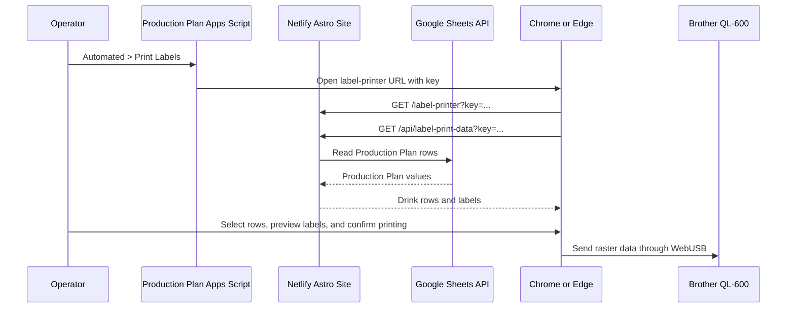

# Production Label Printing

This feature lets a production operator print labels directly from the Production Plan. The operator opens the hosted label-printer page, reviews the labels generated from the plan, connects the Brother QL-600 through the browser, and prints the selected rows.

The goal is to keep the Production Plan as the source of truth and let any authorized operator print from the browser on the computer connected to the printer. The only local requirement is Chrome or Edge on that computer.

## Communication Flow



## Services And Responsibilities

`Production Plan Apps Script` adds a menu item and opens the hosted label-printer page. This is a one-time spreadsheet setup.

`Netlify Astro site` serves the printer UI and exposes `/api/label-print-data`. The API validates the shared restock key before reading Google Sheets.

`Google Sheets API` provides the Production Plan rows. The label printer reuses the same sheet-loading helpers as the restock workflow.

`Chrome or Edge WebUSB` asks the operator for permission to access the locally connected QL-600, then sends the raster print job to the printer.

`Brother QL-600` receives Brother raster commands for DK-1204 labels.

## Production Plan Inputs

The label API reads these Production Plan fields:

- `Drink Variation`
- `Amount to Make`
- `Amount to 30TH`
- `Slot (30TH)`
- `Amount to Towne`
- `Slot (Towne)`

Machine columns come from `MACHINE_CONFIG` in `src/lib/restock/config.js`, so new machine labels should be added there instead of adding another label-specific mapping.

## Label Output

Each label contains:

- Full drink variation name
- Expiration date
- Optional machine and slot code

The expiration date is the current UTC date plus seven days when the plan is loaded. Reload the plan if the page has remained open overnight.

Machine labels receive a code in the top-left corner:

- `30TH#<slot>` for 30th
- `TWNE#<slot>` for Towne

When the Production Plan assigns multiple slots to a drink, the label uses the list exactly as the plan expresses it, for example `30TH#14,15`.

Storage labels leave the top-left corner blank.

For each Production Plan row, total labels come from `Amount to Make`, plus one backup label for that drink variation. Machine labels are generated from the machine amount and slot columns. Any remaining labels become storage labels. The backup label is blank in the top-left corner, like a storage label.

## Printing Behavior

The page has no recipe grouping. Each selected drink row is one print job, with no cuts between its labels and a cut at the end. Print Selected opens a scrollable preview of every label before anything is sent to USB. The operator can uncheck individual labels in the preview, including printing just one as a test.

The page starts with every row selected. Operators can clear the top checkbox or uncheck individual drink variations before printing.

## Changing Label Behavior

Update label data rules in:

```text
src/lib/label-printer/production-plan.js
```

Update visual label layout and raster generation in:

```text
src/lib/label-printer/raster.js
```

The active stock profile is `LABEL_MEDIA` in `src/lib/label-printer/media.js`. It owns the printable dot dimensions, physical stock dimensions, and media command fields. Preview and raster dimensions both come from that profile. A different stock needs its verified profile selected there; changing label stock does not change the QL-600 printhead width.

Update browser connection behavior in:

```text
src/lib/label-printer/webusb.js
```

Update the printer dialog UI in:

```text
src/components/label-printer/LabelPrinterShell.astro
```

To support a new printer, the browser must be able to claim the USB device through WebUSB, and the printer must accept raster commands that the app can generate. A printer with a different command language or label geometry will need a new raster module.

## One-Time Apps Script Setup

These steps have already been taken in the Production Plan Apps Script project. The Apps Script source lives with the spreadsheet project rather than this repository. To view it, open the Production Plan spreadsheet and choose `Extensions > Apps Script`.

The spreadsheet script needs a function named `openLabelPrinter()` that opens the hosted label-printer page using these Apps Script project properties:

```text
LABEL_PRINTER_URL=https://YOUR_NETLIFY_DEPLOY/label-printer
LABEL_PRINTER_KEY=YOUR_RESTOCK_KEY
```

The existing `onOpen()` menu should include:

```js
.addItem('Print Labels', 'openLabelPrinter')
```

The existing `runEverything()` flow can also show the same printer link after recipe cards and inventory finish.

## Operator Runbook

See [operator instructions and troubleshooting](./OPERATOR_HELP.md). The page imports that Markdown file directly into its Help section, so edits update both the documentation and the UI.

## Local Development

Run the site locally:

```sh
npm run dev
```

Open:

```text
http://localhost:4321/label-printer?key=YOUR_RESTOCK_KEY
```

The local page still requires the shared restock key. WebUSB works on `localhost` for development and requires HTTPS when hosted.

## Verification

- `npm test` checks label data, UTC date boundaries, API error handling, and raster command boundaries.
- `npm run test:labels` runs Playwright on desktop and mobile viewports. It uses the real page and renderer with mocked plan responses and a simulated USB device, covering full preview, slot lists, selection, single-label printing, and failures. It does not send anything to a physical printer.
- `npm run test:integration -- tests/integration/label-print-data.integration.test.js` reads the configured Google Sheet through the real API handler. Use a test sheet and the existing integration environment settings. This label test never writes to Sheets; other integration tests in the repository do, so run this file explicitly.
- Before release, print one label and a multi-label drink row on the QL-600 to verify physical alignment and the final cut. Browser tests cannot verify printer mechanics.

Install Chromium once for browser tests with `npx playwright install chromium`.
